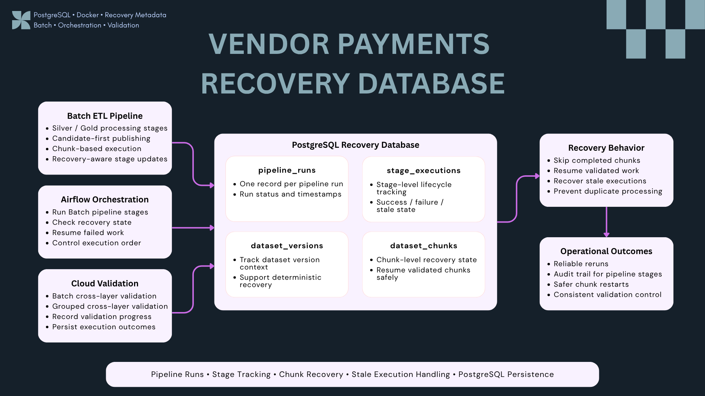

# Vendor Payments Recovery Database


PostgreSQL recovery and execution-metadata layer for the Vendor Payments Data Platform.

This repository does **not** store the main Vendor Payments business dataset. Instead, it acts as an operational metadata store that records pipeline runs, stage execution state, dataset versions, chunk-level progress, stale executions, and recovery checkpoints used by the Batch ETL and Airflow orchestration layers.

---

## Project Summary

The Recovery Database adds persistent execution state to the Batch pipeline so processing can be resumed safely after interruptions instead of restarting every unit of work from the beginning.

It is responsible for:

- Tracking pipeline runs and their lifecycle state
- Recording stage-level execution status
- Recording dataset-version context
- Tracking chunk-level execution and validation state
- Skipping chunks that already completed successfully
- Supporting deterministic reruns
- Recovering stale executions
- Recording Batch validation stages
- Providing persistent metadata used by Airflow and the Batch ETL pipeline

Core design principle:

```text
Business data
→ remains in Batch / S3 / Redshift

Operational recovery state
→ PostgreSQL Recovery Database
```

---

## Architecture



```text
Batch ETL Pipeline ─────────┐
                            │
Airflow Orchestration ──────┼──→ PostgreSQL Recovery Database
                            │
Cloud Validation ───────────┘
                                     │
                                     ↓
                              Recovery Behavior
                                     │
                                     ↓
                              Operational Outcomes
```

The database acts as a shared recovery-control layer rather than a replacement for the platform's analytical storage.

---

## Recovery Metadata Model

### `pipeline_runs`

Stores one record per pipeline execution.

Typical responsibilities:

- Pipeline run identity
- Run status
- Start / finish timestamps
- Overall execution lifecycle
- Relationship to dataset-version context

---

### `stage_executions`

Tracks stage-level processing state.

Examples of tracked stages include:

```text
Silver transformation
Silver validation
Gold build
Gold validation
Batch cross-layer validation
Grouped cross-layer validation
```

This allows the platform to distinguish between stages that are:

```text
running
success
failed
stale
```

---

### `dataset_versions`

Provides dataset-version context for deterministic recovery.

The Batch pipeline uses a dataset version identifier so chunk state belongs to a specific processing context instead of being treated as globally reusable state.

```text
Dataset Version
      ↓
Pipeline Run
      ↓
Stage Execution
      ↓
Chunk Execution
```

---

### `dataset_chunks`

Stores chunk-level recovery metadata.

The current Batch pipeline processes more than 3.35 million source records in bounded chunks, so chunk state is persisted independently.

This allows the pipeline to:

- Detect chunks that already completed successfully
- Skip validated chunks
- Resume incomplete work
- Avoid unnecessary duplicate processing
- Recover safely after partial failure

---

## Recovery Flow

A simplified recovery-aware Batch flow:

```text
Start Batch Run
      ↓
Resolve Dataset Version
      ↓
Check Recovery State
      ↓
Transform Silver in Chunks
      ↓
Persist Chunk State
      ↓
Validate Silver
      ↓
Build Gold
      ↓
Validate Gold
      ↓
Run Cloud Validation
      ↓
Persist Final Stage State
      ↓
Complete Pipeline Run
```

For reruns:

```text
Existing validated chunk
→ skip

Incomplete chunk
→ process again

Stale execution
→ recover and continue
```

---

## Integration with Batch ETL

The Batch ETL repository owns Raw → Silver → Gold transformation logic.

The Recovery Database does not perform those transformations. Instead, it provides persistent state used by recovery-aware pipeline code.

```text
vendor-payments-etl-analytics
        ↓
Chunk processing
        ↓
Recovery metadata updates
        ↓
vendor-payments-database
```

Current Batch behavior includes:

- Candidate-first Silver publishing
- Candidate-first Gold publishing
- 100,000-row chunk processing
- Recovery-aware chunk execution
- Validation gates before publication
- Safe rerun behavior

Repository:

[**vendor-payments-etl-analytics**](https://github.com/Chu-Thana/vendor-payments-etl-analytics)

---

## Integration with Airflow

Airflow uses the Recovery Database as part of the Batch orchestration lifecycle.

```text
start
↓
check_recovery_db
↓
transform_silver
↓
check_silver
↓
build_gold
↓
check_gold
↓
cloud processing
↓
cross-layer validation
↓
grouped cross-layer validation
↓
end
```

The Recovery Database allows Airflow-driven reruns to retain execution history instead of treating every retry as an entirely new stateless operation.

Repository:

[**vendor-payments-airflow-orchestration**](https://github.com/Chu-Thana/vendor-payments-airflow-orchestration)

---

## Validation Stage Tracking

Recovery metadata also records validation progress.

The current implementation includes execution stages for:

- Silver validation
- Gold validation
- Batch Athena ↔ Redshift validation
- Grouped cross-layer validation

The grouped validation stage was added as the latest recovery-stage extension so validation progress remains visible in the same execution model as transformation work.

---

## Stale Execution Recovery

A pipeline process can terminate without writing a clean final state.

For example:

```text
running
↓
process crashes
↓
record remains running
```

The recovery model includes stale-execution handling so abandoned work can be identified and safely recovered instead of remaining permanently in an active state.

This is especially useful for:

- Interrupted chunk processing
- Worker failure
- Manual pipeline termination
- Airflow task interruption
- Retry scenarios

---

## Why PostgreSQL?

PostgreSQL is used here because the recovery layer needs transactional, queryable, durable operational state.

It provides:

- Relational integrity
- Persistent execution metadata
- Transactional updates
- Structured querying
- Clear relationships between runs, stages, versions, and chunks
- Easy integration with Python and Airflow

The database is intentionally separate from analytical storage such as Amazon S3 and Redshift.

```text
PostgreSQL
→ operational / recovery metadata

Amazon S3
→ Data Lake

Amazon Redshift
→ analytical warehouse
```

---

## Docker Environment

The database runs in Docker for reproducible local development.

The current environment uses PostgreSQL 16 and a dedicated recovery database container.

Typical local workflow:

```powershell
docker compose up -d
docker compose ps
```

Check database readiness:

```powershell
docker exec vendor-payments-postgres pg_isready
```

The exact local connection configuration is kept outside committed source files.

---

## SQL Migrations

Database changes are managed as ordered SQL migrations.

The repository contains migration history for recovery capabilities such as:

```text
pipeline run tracking
stage execution tracking
dataset version tracking
chunk-level recovery
stale execution recovery
pipeline status refresh
grouped cross-layer validation stage
runtime timestamp handling
```

Migration files are stored under:

```text
sql/
```

This keeps schema evolution explicit and reviewable.

---

## Example Recovery Concepts

### Skip Completed Chunk

```text
Chunk 001 → validated → skip
Chunk 002 → validated → skip
Chunk 003 → incomplete → process
```

### Recover Stale Work

```text
Stage status = running
Last update exceeds expected lifecycle
→ mark / handle as stale
→ allow controlled recovery
```

### Resume Dataset Processing

```text
Dataset Version
├── Chunk 001 → complete
├── Chunk 002 → complete
├── Chunk 003 → complete
├── Chunk 004 → failed
└── Chunk 005 → pending

Rerun
→ continue from incomplete work
```

---

## Role in the Vendor Payments Data Platform

```text
Batch ETL
→ Recovery Database
→ Airflow
→ S3
→ Athena
→ Redshift
→ FastAPI
→ React / Power BI
```

The Recovery Database adds durable execution state to the platform without mixing operational metadata with analytical business data.

---

## Related Repositories

| Repository | Responsibility |
| --- | --- |
| [**vendor-payments-etl-analytics**](https://github.com/Chu-Thana/vendor-payments-etl-analytics) | Batch ETL, Silver / Gold processing, validation and chunk execution |
| [**vendor-payments-streaming-pipeline**](https://github.com/Chu-Thana/vendor-payments-streaming-pipeline) | Kafka Streaming, Redis deduplication and bounded windows |
| [**vendor-payments-airflow-orchestration**](https://github.com/Chu-Thana/vendor-payments-airflow-orchestration) | Batch, Streaming and platform orchestration |
| [**vendor-payments-cloud-data-platform**](https://github.com/Chu-Thana/vendor-payments-cloud-data-platform) | S3, Athena, Redshift and cross-layer validation |
| [**vendor-payments-api-serving**](https://github.com/Chu-Thana/vendor-payments-api-serving) | FastAPI serving layer |
| [**data-engineering-platform**](https://github.com/Chu-Thana/data-engineering-platform) | Integrated architecture, React analytics and Power BI |

---

## Key Engineering Decisions

### Why not store business data here?

The purpose of this database is execution recovery, not analytical serving.

Keeping recovery metadata separate avoids mixing:

```text
pipeline control state
```

with:

```text
business records
```

---

### Why track chunks individually?

A multi-million-row Batch pipeline should not repeat all completed work after a partial failure.

Chunk-level state allows bounded recovery and safer reruns.

---

### Why keep stage-level state as well as chunk-level state?

They answer different questions.

```text
Stage state
→ Where is the pipeline lifecycle?

Chunk state
→ Which units of data work are complete?
```

Both are required for useful recovery behavior.

---

### Why recover stale executions?

A process may terminate before writing `failed` or `success`.

Stale detection prevents abandoned `running` records from blocking future recovery.

---

## Planned Improvements

Possible future improvements include:

- Stronger transactional coupling between pipeline work and recovery state
- More explicit retry-attempt history
- Recovery dashboards and observability
- Automated stale-execution alerts
- Retention and archival policies
- Additional dataset-version lineage
- More detailed chunk execution metrics
- Production secret management

---

## Key Takeaway

The Recovery Database turns the Batch pipeline from a mostly stateless execution model into a recovery-aware workflow with persistent operational state.

```text
Pipeline Runs
+ Stage Tracking
+ Dataset Versions
+ Chunk Recovery
+ Stale Execution Handling
= Safer and more observable reruns
```

It provides the control-state foundation needed for reliable Batch recovery while keeping analytical business data in the appropriate Data Lake and warehouse layers.
